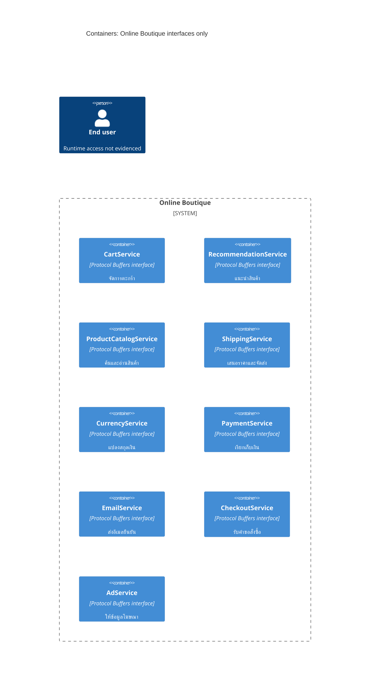

# กู้คืนสถาปัตยกรรม — Run A

## Agent
Codex; ไม่ทราบชื่อโมเดลที่แน่นอน

> จัดทำใน session รวมตามคำขอผู้ใช้ ไม่ใช่ run ที่แยกบริบท ผลนี้จำกัดคำกล่าวอ้างจาก interface แต่ไม่ถือเป็นการทดลองแบบควบคุม

## Files read
หลักฐานสำหรับผลนี้: `system/online-boutique/protos/demo.proto` รายการไฟล์ทั้งหมดที่อ่านร่วม session อยู่ใน `files-read.md`

## Containers table
เป็น service interface เชิงตรรกะ ยังยืนยันไม่ได้ว่าแต่ละ interface เป็น deployment แยกกัน

| ชื่อ | เทคโนโลยี/ภาษา | หน้าที่ | หลักฐาน |
|---|---|---|---|
| CartService | Protocol Buffers; ภาษาของ implementation ไม่ปรากฏ | จัดการตะกร้า | `system/online-boutique/protos/demo.proto` (`CartService.AddItem / GetCart / EmptyCart`) |
| RecommendationService | Protocol Buffers; ภาษาของ implementation ไม่ปรากฏ | แนะนำสินค้า | `system/online-boutique/protos/demo.proto` (`RecommendationService.ListRecommendations`) |
| ProductCatalogService | Protocol Buffers; ภาษาของ implementation ไม่ปรากฏ | ค้นและอ่านสินค้า | `system/online-boutique/protos/demo.proto` (`ProductCatalogService.ListProducts / GetProduct / SearchProducts`) |
| ShippingService | Protocol Buffers; ภาษาของ implementation ไม่ปรากฏ | เสนอราคาและจัดส่ง | `system/online-boutique/protos/demo.proto` (`ShippingService.GetQuote / ShipOrder`) |
| CurrencyService | Protocol Buffers; ภาษาของ implementation ไม่ปรากฏ | แปลงสกุลเงิน | `system/online-boutique/protos/demo.proto` (`CurrencyService.Convert / GetSupportedCurrencies`) |
| PaymentService | Protocol Buffers; ภาษาของ implementation ไม่ปรากฏ | เรียกเก็บเงิน | `system/online-boutique/protos/demo.proto` (`PaymentService.Charge`) |
| EmailService | Protocol Buffers; ภาษาของ implementation ไม่ปรากฏ | ส่งอีเมลยืนยัน | `system/online-boutique/protos/demo.proto` (`EmailService.SendOrderConfirmation`) |
| CheckoutService | Protocol Buffers; ภาษาของ implementation ไม่ปรากฏ | รับคำขอสั่งซื้อ | `system/online-boutique/protos/demo.proto` (`CheckoutService.PlaceOrder`) |
| AdService | Protocol Buffers; ภาษาของ implementation ไม่ปรากฏ | ให้ข้อมูลโฆษณา | `system/online-boutique/protos/demo.proto` (`AdService.GetAds`) |

## Dependencies table
| ผู้เรียก → ผู้ถูกเรียก | Protocol | หลักฐาน |
|---|---|---|
| ไม่พบคู่ผู้เรียก → ผู้ถูกเรียก | Not evidenced in the provided files | RPC declaration ไม่ระบุ client หรือเส้นทาง runtime |

## Mermaid diagram

## Gaps
- frontend, data store, deployment topology, implementation languages และคู่ dependency: Not evidenced in the provided files; ตรวจ Kubernetes manifests และ source ของ client เพิ่มเติม
- [Inferred] RPC interface น่าจะใช้กับ gRPC แต่ `.proto` เพียงอย่างเดียวไม่ยืนยัน transport ที่ใช้งานจริง
- การมี `OrderResult` ใน email request ไม่พิสูจน์ว่า CheckoutService เป็นผู้เรียก EmailService
