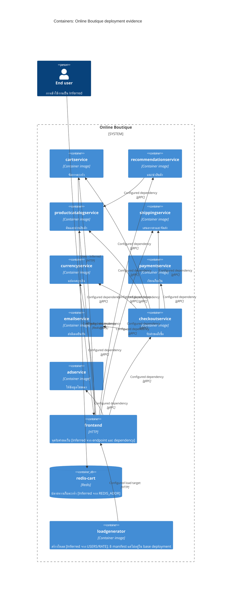

# กู้คืนสถาปัตยกรรม — Run B

## Agent
Codex; ไม่ทราบชื่อโมเดลที่แน่นอน

> จัดทำใน session รวม ไม่ใช่ run ที่แยกบริบท

## Files read
หลักฐานสำหรับผลนี้:
- `system/online-boutique/protos/demo.proto`
- `system/online-boutique/kubernetes-manifests/adservice.yaml`
- `system/online-boutique/kubernetes-manifests/cartservice.yaml`
- `system/online-boutique/kubernetes-manifests/checkoutservice.yaml`
- `system/online-boutique/kubernetes-manifests/currencyservice.yaml`
- `system/online-boutique/kubernetes-manifests/emailservice.yaml`
- `system/online-boutique/kubernetes-manifests/frontend.yaml`
- `system/online-boutique/kubernetes-manifests/kustomization.yaml`
- `system/online-boutique/kubernetes-manifests/loadgenerator.yaml`
- `system/online-boutique/kubernetes-manifests/paymentservice.yaml`
- `system/online-boutique/kubernetes-manifests/productcatalogservice.yaml`
- `system/online-boutique/kubernetes-manifests/recommendationservice.yaml`
- `system/online-boutique/kubernetes-manifests/shippingservice.yaml`

ไฟล์อื่นที่อ่านร่วม session ระบุครบใน `files-read.md`

## Containers table
| ชื่อ/alias | เทคโนโลยี/ภาษา | หน้าที่ | หลักฐาน |
|---|---|---|---|
| cartservice | image: cartservice; ภาษา implementation ไม่ปรากฏ | จัดการตะกร้า | system/online-boutique/kubernetes-manifests/cartservice.yaml (Deployment, image); system/online-boutique/protos/demo.proto (CartService) |
| recommendationservice | image: recommendationservice; ภาษา implementation ไม่ปรากฏ | แนะนำสินค้า | system/online-boutique/kubernetes-manifests/recommendationservice.yaml (Deployment, image); system/online-boutique/protos/demo.proto (RecommendationService) |
| productcatalogservice | image: productcatalogservice; ภาษา implementation ไม่ปรากฏ | ค้นและอ่านสินค้า | system/online-boutique/kubernetes-manifests/productcatalogservice.yaml (Deployment, image); system/online-boutique/protos/demo.proto (ProductCatalogService) |
| shippingservice | image: shippingservice; ภาษา implementation ไม่ปรากฏ | เสนอราคาและจัดส่ง | system/online-boutique/kubernetes-manifests/shippingservice.yaml (Deployment, image); system/online-boutique/protos/demo.proto (ShippingService) |
| currencyservice | image: currencyservice; ภาษา implementation ไม่ปรากฏ | แปลงสกุลเงิน | system/online-boutique/kubernetes-manifests/currencyservice.yaml (Deployment, image); system/online-boutique/protos/demo.proto (CurrencyService) |
| paymentservice | image: paymentservice; ภาษา implementation ไม่ปรากฏ | เรียกเก็บเงิน | system/online-boutique/kubernetes-manifests/paymentservice.yaml (Deployment, image); system/online-boutique/protos/demo.proto (PaymentService) |
| emailservice | image: emailservice; ภาษา implementation ไม่ปรากฏ | ส่งอีเมลยืนยัน | system/online-boutique/kubernetes-manifests/emailservice.yaml (Deployment, image); system/online-boutique/protos/demo.proto (EmailService) |
| checkoutservice | image: checkoutservice; ภาษา implementation ไม่ปรากฏ | รับคำขอสั่งซื้อ | system/online-boutique/kubernetes-manifests/checkoutservice.yaml (Deployment, image); system/online-boutique/protos/demo.proto (CheckoutService) |
| adservice | image: adservice; ภาษา implementation ไม่ปรากฏ | ให้ข้อมูลโฆษณา | system/online-boutique/kubernetes-manifests/adservice.yaml (Deployment, image); system/online-boutique/protos/demo.proto (AdService) |
| frontend | image: frontend; HTTP | จุดรับคำขอเว็บ [Inferred จาก endpoint และ dependency] | system/online-boutique/kubernetes-manifests/frontend.yaml (frontend-external, httpGet, env) |
| redis_cart | Redis (redis:alpine) | ปลายทางเก็บตะกร้า [Inferred จาก REDIS_ADDR] | system/online-boutique/kubernetes-manifests/cartservice.yaml (redis-cart, REDIS_ADDR) |
| loadgenerator | image: loadgenerator | สร้างโหลด [Inferred จาก USERS/RATE]; มี manifest แต่ไม่อยู่ใน base deployment | system/online-boutique/kubernetes-manifests/loadgenerator.yaml (USERS, RATE); system/online-boutique/kubernetes-manifests/kustomization.yaml (บรรทัดที่ comment loadgenerator) |

## Dependencies table
เป็น dependency ที่ตั้งค่าไว้ ไม่ใช่หลักฐานว่าแต่ละเส้นถูกเรียกทุก request; protocol ยืนยันจากชื่อ Service port ร่วมกับ RPC interface

| ผู้เรียก → ผู้ถูกเรียก | Protocol | หลักฐาน |
|---|---|---|
| frontend → productcatalogservice | gRPC | `system/online-boutique/kubernetes-manifests/frontend.yaml (PRODUCT_CATALOG_SERVICE_ADDR); system/online-boutique/kubernetes-manifests/productcatalogservice.yaml (Service.ports.name: grpc)` |
| frontend → currencyservice | gRPC | `system/online-boutique/kubernetes-manifests/frontend.yaml (CURRENCY_SERVICE_ADDR); system/online-boutique/kubernetes-manifests/currencyservice.yaml (Service.ports.name: grpc)` |
| frontend → cartservice | gRPC | `system/online-boutique/kubernetes-manifests/frontend.yaml (CART_SERVICE_ADDR); system/online-boutique/kubernetes-manifests/cartservice.yaml (Service.ports.name: grpc)` |
| frontend → recommendationservice | gRPC | `system/online-boutique/kubernetes-manifests/frontend.yaml (RECOMMENDATION_SERVICE_ADDR); system/online-boutique/kubernetes-manifests/recommendationservice.yaml (Service.ports.name: grpc)` |
| frontend → shippingservice | gRPC | `system/online-boutique/kubernetes-manifests/frontend.yaml (SHIPPING_SERVICE_ADDR); system/online-boutique/kubernetes-manifests/shippingservice.yaml (Service.ports.name: grpc)` |
| frontend → checkoutservice | gRPC | `system/online-boutique/kubernetes-manifests/frontend.yaml (CHECKOUT_SERVICE_ADDR); system/online-boutique/kubernetes-manifests/checkoutservice.yaml (Service.ports.name: grpc)` |
| frontend → adservice | gRPC | `system/online-boutique/kubernetes-manifests/frontend.yaml (AD_SERVICE_ADDR); system/online-boutique/kubernetes-manifests/adservice.yaml (Service.ports.name: grpc)` |
| checkoutservice → productcatalogservice | gRPC | `system/online-boutique/kubernetes-manifests/checkoutservice.yaml (PRODUCT_CATALOG_SERVICE_ADDR); system/online-boutique/kubernetes-manifests/productcatalogservice.yaml (Service.ports.name: grpc)` |
| checkoutservice → shippingservice | gRPC | `system/online-boutique/kubernetes-manifests/checkoutservice.yaml (SHIPPING_SERVICE_ADDR); system/online-boutique/kubernetes-manifests/shippingservice.yaml (Service.ports.name: grpc)` |
| checkoutservice → paymentservice | gRPC | `system/online-boutique/kubernetes-manifests/checkoutservice.yaml (PAYMENT_SERVICE_ADDR); system/online-boutique/kubernetes-manifests/paymentservice.yaml (Service.ports.name: grpc)` |
| checkoutservice → emailservice | gRPC | `system/online-boutique/kubernetes-manifests/checkoutservice.yaml (EMAIL_SERVICE_ADDR); system/online-boutique/kubernetes-manifests/emailservice.yaml (Service.ports.name: grpc)` |
| checkoutservice → currencyservice | gRPC | `system/online-boutique/kubernetes-manifests/checkoutservice.yaml (CURRENCY_SERVICE_ADDR); system/online-boutique/kubernetes-manifests/currencyservice.yaml (Service.ports.name: grpc)` |
| checkoutservice → cartservice | gRPC | `system/online-boutique/kubernetes-manifests/checkoutservice.yaml (CART_SERVICE_ADDR); system/online-boutique/kubernetes-manifests/cartservice.yaml (Service.ports.name: grpc)` |
| recommendationservice → productcatalogservice | gRPC | `system/online-boutique/kubernetes-manifests/recommendationservice.yaml (PRODUCT_CATALOG_SERVICE_ADDR); system/online-boutique/kubernetes-manifests/productcatalogservice.yaml (Service.ports.name: grpc)` |
| cartservice → redis_cart | Redis/TCP | `system/online-boutique/kubernetes-manifests/cartservice.yaml (REDIS_ADDR, tcp-redis)` |
| user → frontend | HTTP | `system/online-boutique/kubernetes-manifests/frontend.yaml (frontend-external, port 80, name: http); การใช้โดยผู้ใช้เป็น [Inferred]` |
| loadgenerator → frontend | HTTP | `system/online-boutique/kubernetes-manifests/loadgenerator.yaml (FRONTEND_ADDR, initContainers wget http://)` |

## Mermaid diagram

## Gaps
- `frontend.yaml` มี SHOPPING_ASSISTANT_SERVICE_ADDR แต่ ENABLE_ASSISTANT เป็น comment และไม่มี deployment ของเป้าหมายในชุดนี้ จึงยังไม่เพิ่มเป็น runtime container/edge
- loadgenerator เป็นตัวเลือกนอก base kustomization; แผนภาพแสดง manifest ที่มี ไม่อ้างว่าทุกตัวทำงานพร้อมกัน
- Redis ใช้ `emptyDir` ไม่ใช่หลักฐานของ durable persistent volume (`cartservice.yaml`, volumes.redis-data)
- ไม่พบ message broker, MailFast หรือ loyaltyservice ในหลักฐาน run นี้; ไม่เติมจาก scenario ของงานอื่น
- ภาษา implementation, timeout/retry และลำดับคำเรียก: Not evidenced in the provided files; ต้องอ่าน source ของแต่ละ service
- ไม่พบหลักฐาน HTTPS termination จึงระบุเพียง HTTP port 80
